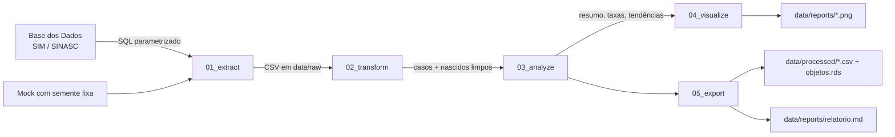

# Arquitetura e uso do pipeline

## Fluxo de dados



Cada módulo é um conjunto de funções com **entrada e saída explícitas**. Nada
de `library()` global, nada de variáveis com estado escondido (exceto o
`PROJECT_ROOT`, que é configurado uma vez na raiz).

## Árvore de arquivos

| Arquivo | Responsabilidade |
|---|---|
| `run_analysis.R` | descobre a raiz, carrega módulos, faz parse da CLI, orquestra |
| `R/utils.R` | `log_info`, `abort_if`, `assert_columns`, `%||%`, `safe_png` |
| `R/00_config.R` | `PROJECT_ROOT`, `DIRS`, `UF_LOOKUP`, `default_config` |
| `R/01_extract.R` | `build_query_cases`, `build_query_births`, `read_sql_cached`, `mock_*` |
| `R/02_transform.R` | `prepare_cases`, `prepare_births`, `add_uf_metadata` |
| `R/03_analyze.R` | `summarize_by_*`, `add_rates`, `fit_trends`, `summary_stats` |
| `R/04_visualize.R` | gráficos base R (sem dependências extras) |
| `R/05_export.R` | CSV/RDS + relatório markdown |
| `R/06_optional_maps.R` | coropletico opcional (ignorado pelo `renv`) |
| `tests/test_pipeline.R` | 23 checagens offline |
| `tools/verificar_csv.R` | valida um CSV baixado manualmente |
| `docs/04-guia-de-dados.md` | passo a passo: dados, formato, caminhos, consumo |

## Como executar

```r
# Do terminal, na raiz do projeto:
Rscript run_analysis.R --mock                      # dados sintéticos
Rscript run_analysis.R                             # SIM real (precisa de billing)
Rscript run_analysis.R --source=sinasc             # SINASC real
Rscript run_analysis.R --years=2015-2019           # recorte
Rscript run_analysis.R --no-cache                  # força nova consulta
Rscript tests/test_pipeline.R                      # testes
Rscript run_analysis.R --help                      # ajuda da CLI
```

No RStudio, abra `EpidemiR.Rproj` e use `Ctrl+Shift+F10` (Source) ou rode
`source("run_analysis.R")`. Para passar argumentos pela IDE:

```r
commandArgs(trailingOnly = TRUE)  # via "Edit R Script Options"
# ou, mais simples, chame direto:
cfg <- default_config(source = "sinasc", years = 2015:2019, mock = TRUE)
```

## Contratos dos módulos

| Função | Entrada | Saída |
|---|---|---|
| `default_config()` | source, years, flags | `list` validado |
| `extract_all(cfg)` | config | `list(cases, births)` data.frames |
| `prepare_cases(df, cfg)` | casos brutos | tibble com `ano, sigla_uf, total, is_imputed, nome, regiao, lon, lat` |
| `prepare_births(df, cfg)` | nascidos brutos | data.frame `ano, sigla_uf, nascidos` |
| `add_rates(cases, births)` | os dois acima | casos + `taxa_100k` |
| `fit_trends(cases)` | casos | `sigla_uf, n, slope, r2, p_value, direction` |
| `summary_stats(cases, rated)` | casos + taxas | list com resumo executivo |
| `make_all_plots(cases, rated, cfg)` | dados + config | vetor nomeado de caminhos PNG |
| `export_tables(...)` | todas as tabelas | vetor nomeado de caminhos de arquivo |
| `write_report_md(...)` | resumo + tabelas | caminho do `.md` |

## Dependências

Instaladas e usadas de fato neste ambiente:

| Pacote | Versão local | Papel |
|---|---|---|
| `basedosdados` | 0.2.3 | consulta BigQuery (`read_sql`) |
| `dplyr` | 1.2.1 | verbs de manipulação |
| `readr` | 2.2.0 | leitura/escrita de CSV |
| `stats`, `graphics`, `grDevices`, `utils` | base | regressão, gráficos, formatação |

Opcionais — o pipeline **não quebra** sem eles:

| Pacote | Habilita | Instalação |
|---|---|---|
| `ggplot2` | gráficos com gramática | `install.packages("ggplot2")` |
| `geobr` | malha geográfica oficial (IBGE) para coroplético | `install.packages("geobr")` |
| `sf` | dependência do `geobr` | instalado junto |
| `testthat` | migração dos testes para o framework | `install.packages("testthat")` |
| `rmarkdown` / `quarto` | relatório narrativo | conforme preferência |

> Sem `ggplot2`/`geobr`, o mapa gerado é de **bolhas sobre centroides
> aproximados** (`fig_mapa_bolhas.png`). Com eles, aparece
> `fig_coropletico.png` com a malha estadual. O arquivo
> `R/06_optional_maps.R` está no `.renvignore` justamente para que esses
> pacotes opcionais não deixem o lockfile permanentemente "out-of-sync".

### Sincronizando o `renv`

O lockfile está desatualizado em relação ao ambiente. Para corrigir:

```r
renv::status()      # mostra o que está fora de sincronia
renv::snapshot()    # registra basedosdados, dplyr, readr etc. no lockfile
renv::restore()     # em outra máquina, reconstrói o ambiente
```

Faça isso numa máquina com internet e commite `renv.lock` resultante.

## Convenções de código

1. **Sempre `pacote::funcao()`** em código de módulo. `library()` só em script
   final, se mesmo assim desejar. Fica explícito o que é base e o que é pacote.
2. **snake_case** para funções/variáveis; `.prefixo` para auxiliares internas;
   MAIÚSCULAS para constantes (`DIRS`, `UF_LOOKUP`).
3. **`abort_if(cond, msg)`** para pré-condições. Erro cedo > erro vago depois.
4. **`log_info(fmt, ...)`** com `sprintf`, nunca `cat()` solto (exceto no resumo
   final e nos testes).
5. **Pipe nativo `|>`** em vez de `%>%` — não exige magrittr.
6. **`on.exit()` em dispositivos gráficos** — ver `safe_png()`.
7. **Validação de fronteira**: config na entrada, dados brutos na entrada de
   cada módulo. O restante confia nos contratos.

## Estendendo o projeto

### Trocar a fonte de dados

`default_config(source = "sinasc")` já ajusta tabela, campo e padrão do CID.
Se quiser uma terceira fonte, adicione o ramo em `default_config()` e um
`build_query_*` em `01_extract.R`.

### Incluir todas as malformações (Q00-Q04)

```r
cfg <- default_config(source = "sim", cid_cases = "Q0%")
# depois rode as etapas com esse cfg, ou acrescente --cid ao parse_cli()
```

### Nova métrica

Crie `minha_metrica(rated)` em `03_analyze.R`, retornando data.frame com a
chave `ano, sigla_uf`. Depois inclua a coluna em `export_tables()` e uma linha
em `write_report_md()`.

### Novo gráfico

Use `safe_png(caminho, { ... })` para garantir que o dispositivo fecha.
Se for ggplot2, use `ggplot2::ggsave()` e proteja com `requireNamespace()`.

### Migrar os testes para testthat

Instale `testthat` e transforme cada `check(cond, "label")` em
`testthat::expect_true(cond, "label")`. A estrutura de `make_checker()` existe
apenas para os testes rodarem hoje sem dependência extra.

## Troubleshooting

| Sintoma | Causa provável | Ação |
|---|---|---|
| `GCP_BILLING_ID vazio` | `.Renviron` ausente ou R iniciado fora do projeto | crie `.Renviron` na raiz e reinicie a sessão |
| `Falha na consulta ... access denied` | conta sem permissão na tabela | aceite os termos do dataset no site da Base dos Dados |
| `The project is out-of-sync` | lockfile incompleto | `renv::snapshot()` |
| Gráfico vazio / estranho | dispositivo vazado de erro anterior | `while (dev.cur() > 1) dev.off()` |
| Dados "de 2015" aparecendo em 2019 | cache antigo em `data/raw/` | rode com `--no-cache` |
| Avisos de `big.mark`/`decimal.mark` | locale | já resolvido em `format_number()` |
| `não foi possível encontrar a função "%>%"` | código copiado de fora | use `|>` (pipe nativo) |
